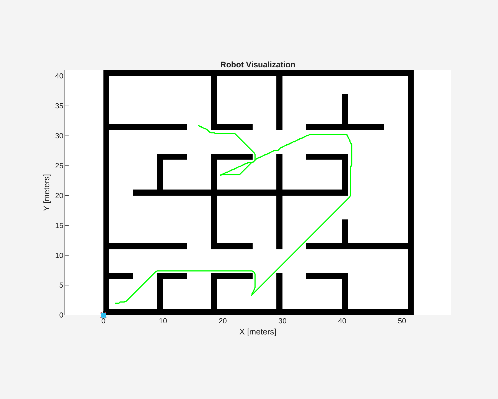
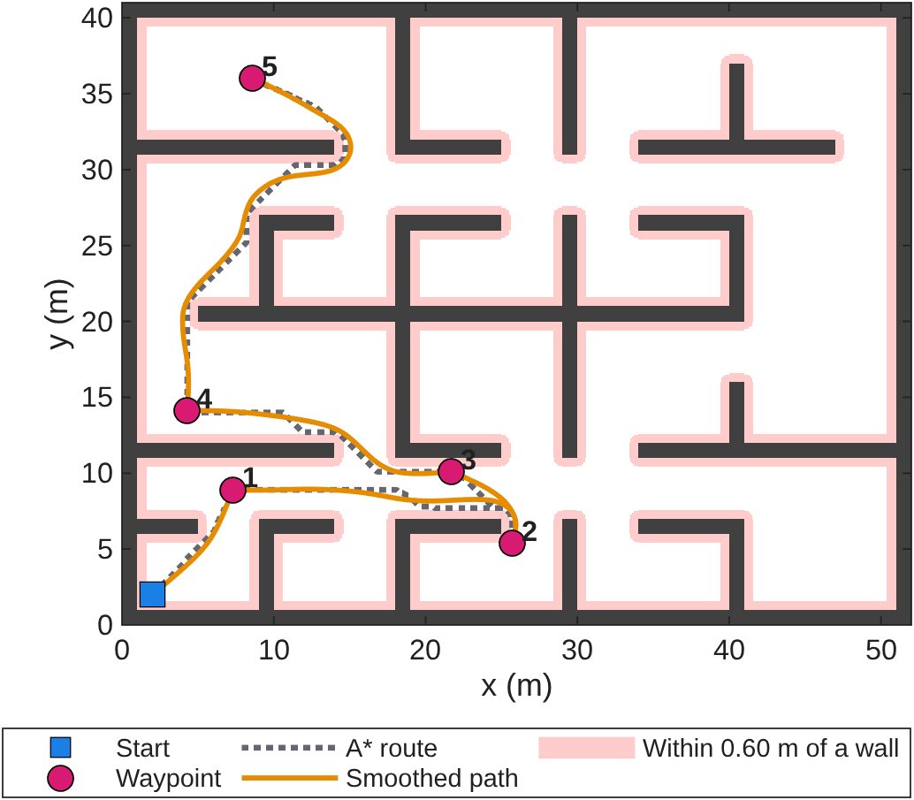
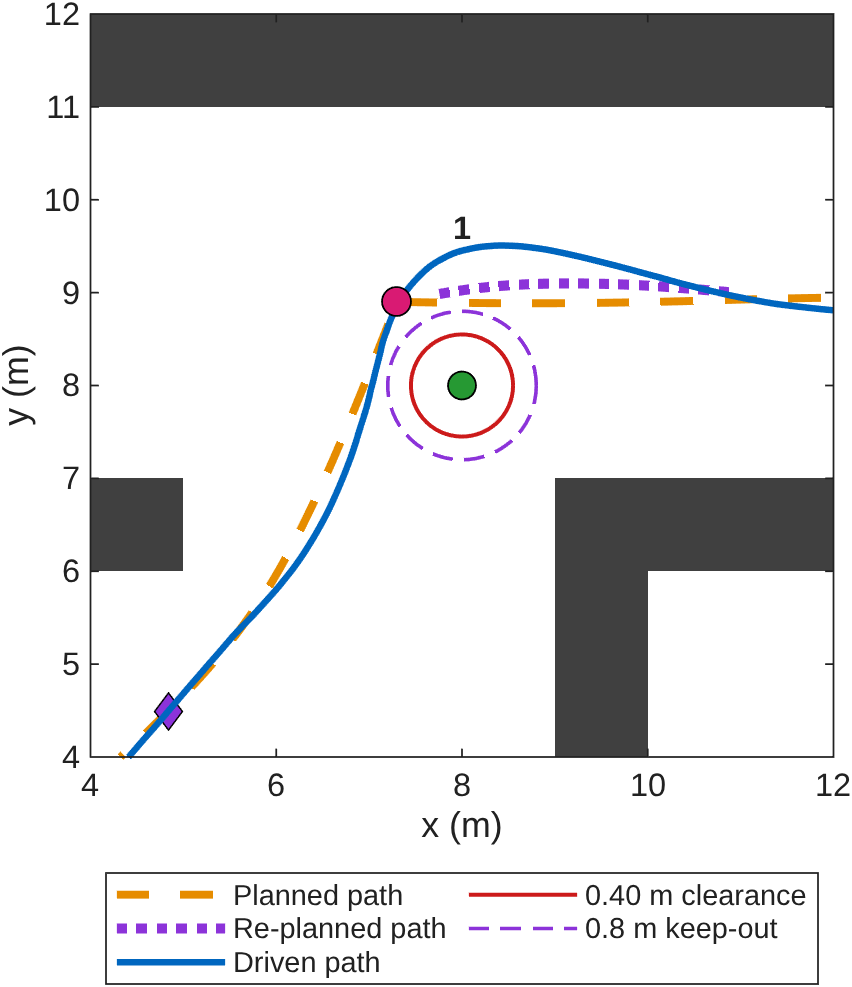
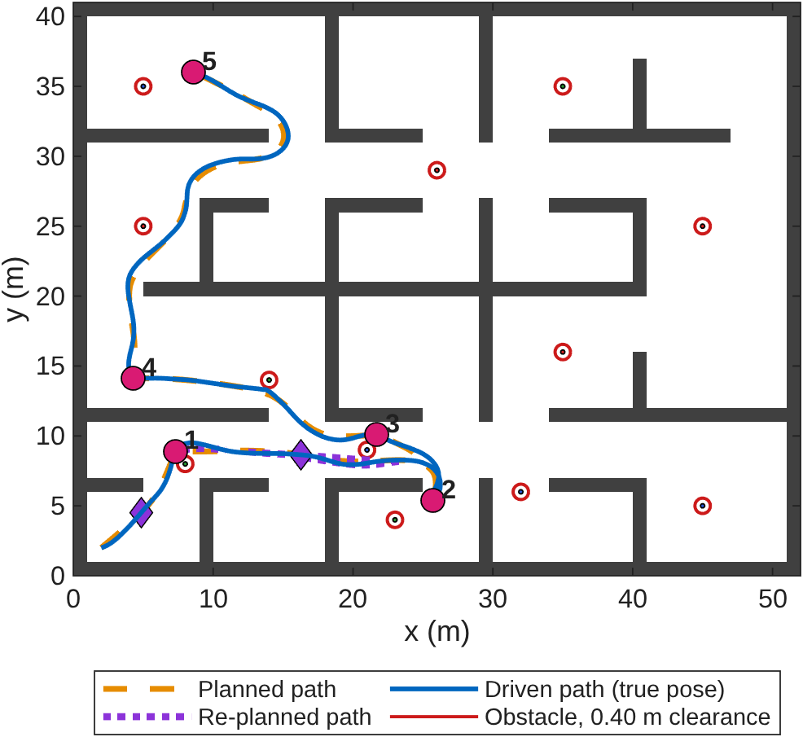
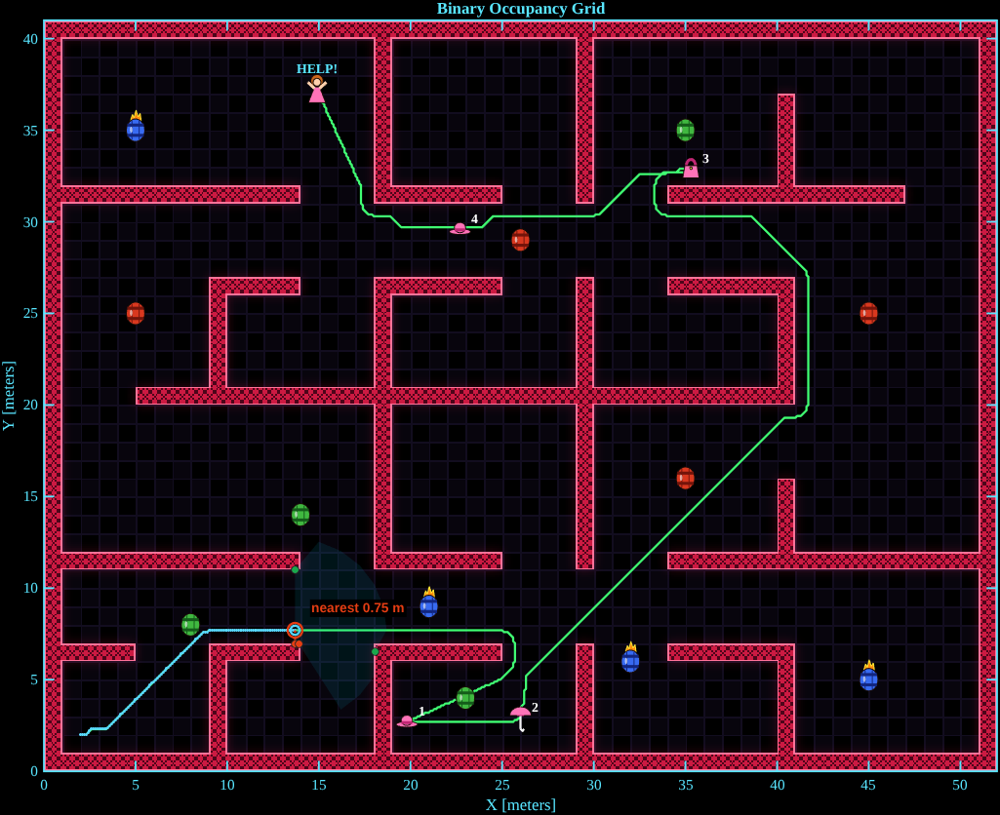

# EGH446 Major Project, Part B

**Path planning and onboard obstacle avoidance for an autonomous ground robot among unmapped obstacles.**

MATLAB/Simulink project for EGH446 Autonomous Systems (QUT, Semester 2 2026), Group 50.
An Ackermann-steered ground robot visits five randomly generated waypoints in a walled
arena that also contains twelve obstacles it does not know about in advance and can only
find with its own sensors.



## How it works

The mission is planned once on the known walls, then repaired during the run as obstacles are detected.

| Stage | Method | Main files |
| --- | --- | --- |
| Waypoint ordering | Ant colony optimisation over true driving distances | `wp_antColony.m`, `waypoint_distances.m` |
| Routing | A* on an occupancy grid inflated for clearance | `A_star.m`, `inflate_map.m`, `clearance_field.m` |
| Smoothing | Particle swarm optimisation of a cubic B-spline per leg | `wp_swarm.m`, `pso_defaults.m`, `path_simplify.m` |
| Online re-planning | Detected obstacles are remembered and the remaining path is re-planned around them | `obstacle_replan.m`, `path_store.m`, `add_replanner.m` |
| Reactive backup | Potential field on object detections, plus lidar wall repulsion | `obstacle_avoidance_block.m` |
| Guidance | Path following with in-order waypoint capture; swaps in a re-planned path mid-run | `guidance_block.txt` |
| Control and estimation | Heading and speed controller with a Kalman filter state estimate, reused from Part A | `controller_params.m` |

Both avoidance layers are designed around a required clearance of **0.40 m** (vehicle radius plus a safety margin).

### Planning

A* fixes which way round the walls each leg goes. PSO then reshapes the curve inside that
corridor so the vehicle can track it, and falls back to the A* path if the smoothed curve
gets too close to a wall.



### Re-planning around an unmapped obstacle

When a detected obstacle lies near the remaining path, that part of the path is re-planned
with a 0.8 m keep-out around it. The potential field only acts as a close-range backup.



### A full mission



## Results

Across 25 seeded missions, measured against the simulator's noise-free pose:

- every waypoint was captured in the optimal order; waypoints 1 to 4 were passed within 0.23 m and the last captured within 0.10 m
- a 108 m mission took 123 s on average, at a 1.0 m/s speed limit
- the smallest clearance was 0.58 m from an obstacle and 0.65 m from a wall (required 0.40 m)
- with re-planning switched off, six of eight test missions breached the obstacle clearance
- the Kalman filter's measurement noise is set from the sensor noise measured against the noise-free pose (0.10 m, 2 deg, 0.1 m/s)

## Running it

Requires MATLAB with Simulink, Stateflow, Robotics System Toolbox and Navigation Toolbox.
The model is saved in R2026a, with up-to-date copies exported for R2025b, R2024b and R2023b alongside it
(`sl_groundvehicleDynamics.slx.r2025b`, `.slx.r2024b` and `sl_groundvehicleDynamics_23b.slx`).

```matlab
cd egh446_simEnv2026_25b/sim_env
startupGround     % adds the toolboxes to the path and opens sl_groundvehicleDynamics
```

Then press **Run** in Simulink. The simulation stops itself once all waypoints are captured.
`GettingStarted.mlx` in the same folder walks through the environment and the map key, and
[`egh446_simEnv2026_25b/README.md`](egh446_simEnv2026_25b/README.md) summarises the subsystems,
parameters and how to reproduce the report's results.

## Visualisation

The Robot Visualization figure is restyled with overlays drawn from MATLAB Function blocks:

- `draw_lidar_view.m`: scan field, mapped walls, nearest-return clearance readout and the arena style
- `draw_avoid_view.m`: guidance heading against the avoidance heading, the intended arc, and a trail over every dodge
- `draw_sensor_waves.m`: animated transmit, bounce and echo lidar pulses

Arena styles include a dungeon (above) and a Donkey Kong level, where the obstacles are barrels
and the waypoints are Pauline's lost items:



## Repository layout

```text
egh446_simEnv2026_25b/
└── sim_env/
    ├── startupGround.m               entry point
    ├── GettingStarted.mlx            guide to the environment
    ├── controller_params.m           controller and guidance tuning
    ├── obstacle_avoidance_block.m    reactive avoidance (code of the Simulink block)
    ├── guidance_block.txt            guidance (code of the Simulink block)
    ├── add_replanner.m               one-off model edit that adds the Replanner block
    ├── add_avoid_viz.m               one-off model edit that adds the avoidance overlay
    ├── draw_*.m                      visualisation overlays
    └── toolboxes/
        ├── ground_robot/             Simulink model, planners (ACO, A*, PSO), re-planner
        └── MRTB/                     MathWorks Mobile Robotics Simulation Toolbox
docs/images/                          figures used in this README
```

## Authors

Chabod Masere, Jonah Menzies and Balin Carkeet (Group 50), Queensland University of Technology.

The simulation environment is provided by the EGH446 teaching team and builds on the
[Mobile Robotics Simulation Toolbox](https://github.com/mathworks-robotics/mobile-robotics-simulation-toolbox) (The MathWorks, Inc.).
